# Box
A data-driven 2D/3D game framework built on [Flecs](https://github.com/SanderMertens/flecs) and WebGPU. Used to build Flecs demo games and as renderer for the [explorer demo scene](https://flecs.dev/explorer).

## What is Box?
What if _everything_ in a game was data driven, reactive and procedural? That is the design space Box is built to explore.

Take this baguette:

[](https://www.flecs.dev/games/baguette/)

It's not the best looking virtual baguette you've ever seen. But it might be the most _flexible_ one! Everything, from its textures to its shape, to the number of cuts in the loaf are procedural and can be modified at runtime.

Here's a snippet that shows what the geometry part of the baguette looks like:
```cpp
template BaguetteLoaf {
  prop length: f32 = 1.2
  prop thickness: f32 = 0.085
  prop height: f32 = 0.8
  prop taper: f32 = 0.5
  prop cuts: i32 = 5
  prop crust: f32 = 2

  const half: f32 = length / 2
  const bend: f32 = taper * half
  const tip: f32 = thickness * 0.1

  profile {
    Path2D: {
      start: {tip, 0 - half}, 
      segments: [
        {kind: CubicBezier, control1: {thickness * 0.35, 0 - half + bend * 0.05},
          control2: {thickness * 0.99, 0 - half + bend * 0.5}, 
          end: {thickness, 0 - half + bend}},
        {kind: Line, end: {thickness, half - bend}},
        {kind: CubicBezier, control1: {thickness * 0.99, half - bend * 0.5},
          control2: {thickness * 0.35, half - bend * 0.05}, end: {tip, half}}
      ]
    }
  }

  crust_shape {
    Position: {0, thickness * height * 0.88, 0}
    Rotation: {PI / 2, 0, 0}
    Scale: {1, 1, height}
    Lathe: {profile: profile, cap_start: true, cap_end: true, segments: 48, rings: 64}
    Rgb: {255, 255, 255}
    PbrMaterial: {roughness: 1}
    PbrTextures: {albedo: alb, normal: nrm, orm: orm} // procedural textures
  }
}
```

This is [Flecs Script](https://www.flecs.dev/flecs/FlecsScript.html). Everything in [this scene](etc/scenes/baguette), from the configuration, the scene structure, the user interface, the geometry and the textures are procedural and defined in flecs script. If the scene had music or sound effects, they would also be created in Flecs Script. All box games are built this way.

Flecs Script is reactive. What this means in short is, if value X depends on value Y, and Y changes, then value X will automatically change as well. Change the `length` of a `BaguetteLoaf` instance, and you automatically change the shape of the bread.

This won't get you AAA level fidelity (though it can still produce decent looking games, see below!). What it does offer is a single, unified API that works seamlessly across each part of the framework. Want to generate audio effects that modulate with your characters evilness stat? Easy! Want to turn on or off a particle effect based on whether your ship's engine is firing? Piece of cake!

By reducing everything to entities, components and reactivity, I think Box demonstrates that ECS can make game development _easier_, not harder.

## Screenshots
[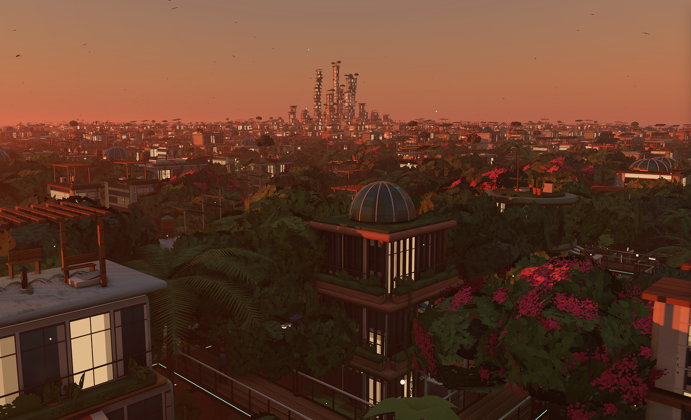](https://www.flecs.dev/games/jungle_city/)
[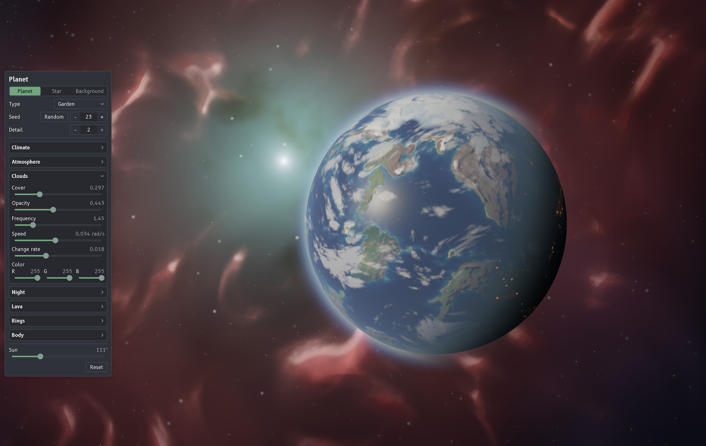](https://www.flecs.dev/games/planet/)
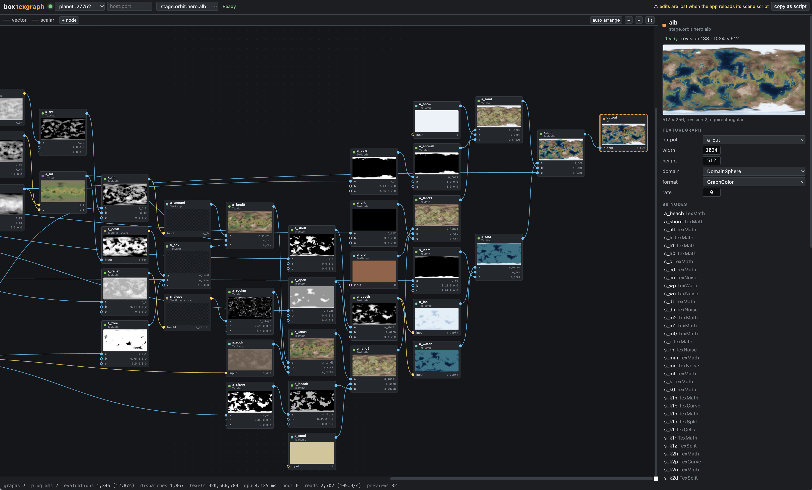
[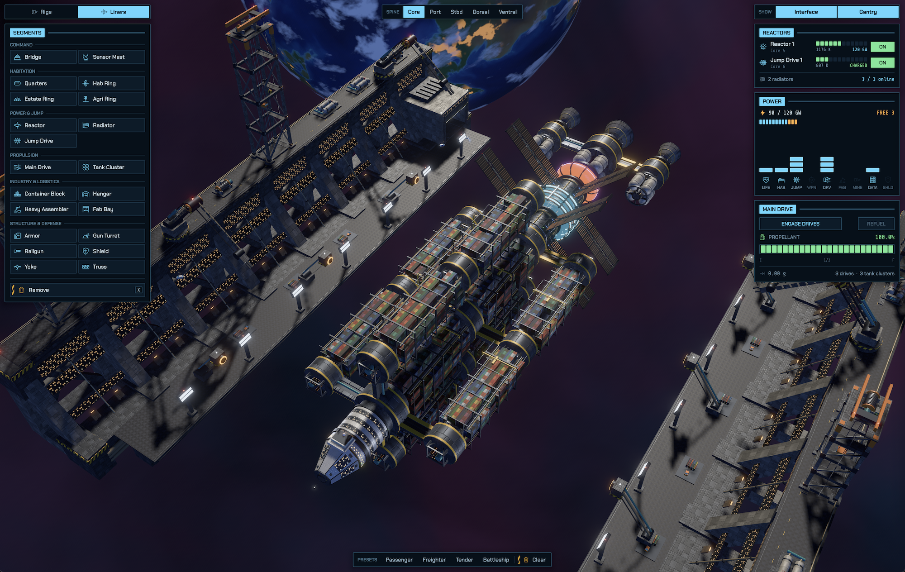](https://www.flecs.dev/games/shipyard/)
[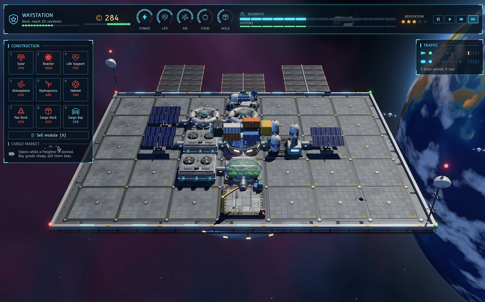](https://www.flecs.dev/games/space_station/)
[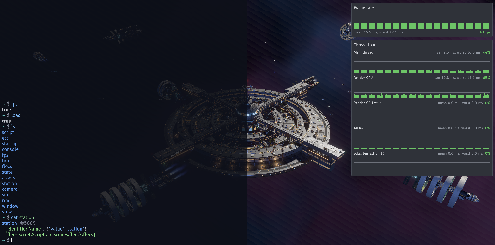](https://www.flecs.dev/games/fleet/)
[](https://www.flecs.dev/games/dust_merchant/)
[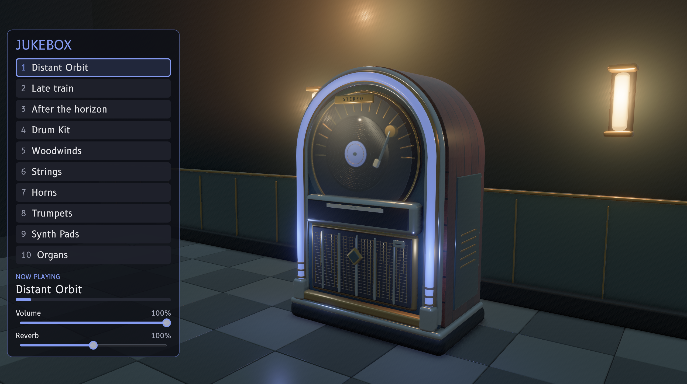](https://www.flecs.dev/games/jukebox/)
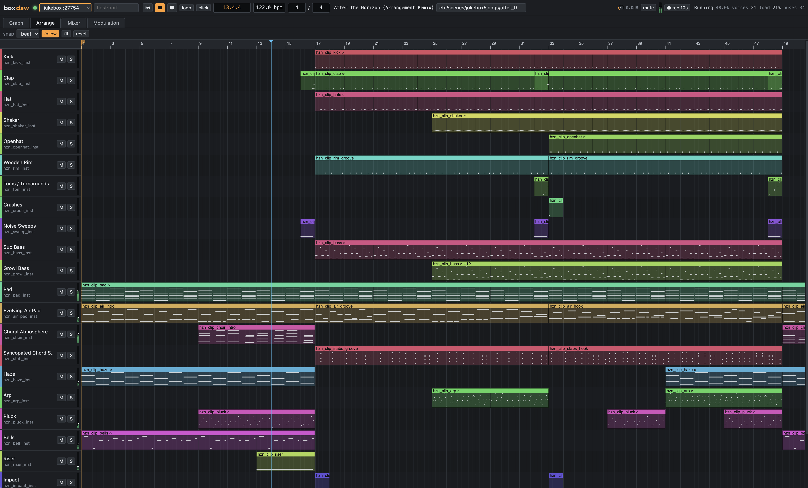
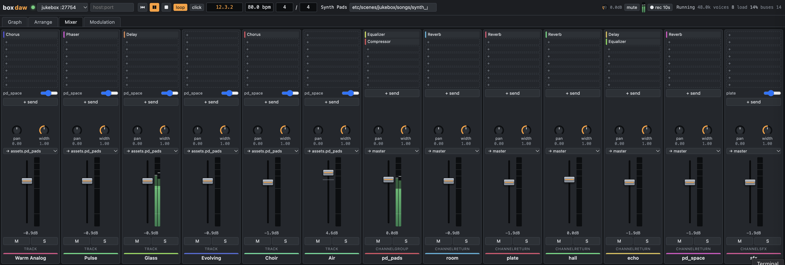
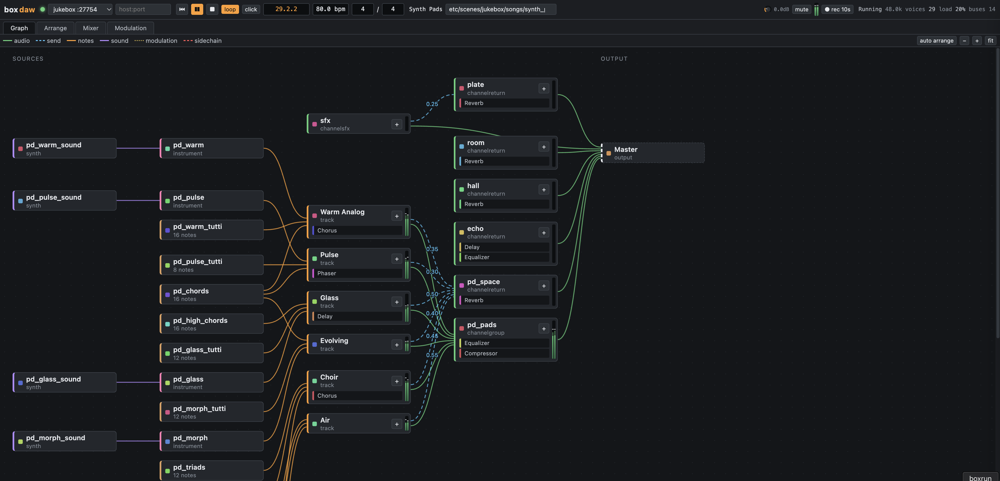
[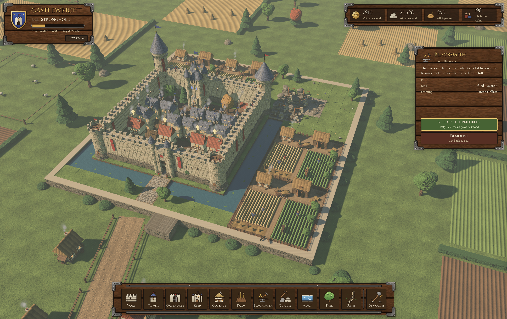](https://www.flecs.dev/games/castle/)
[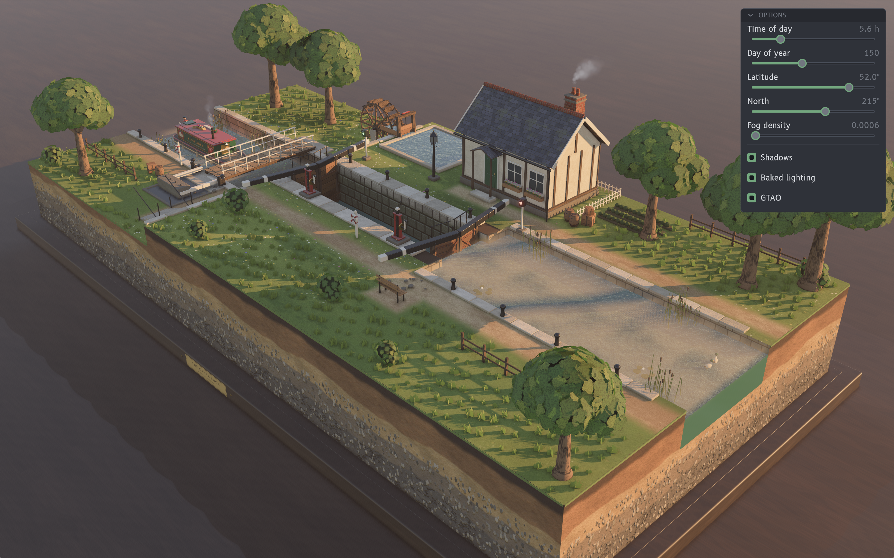](https://www.flecs.dev/games/canal_lock/)
[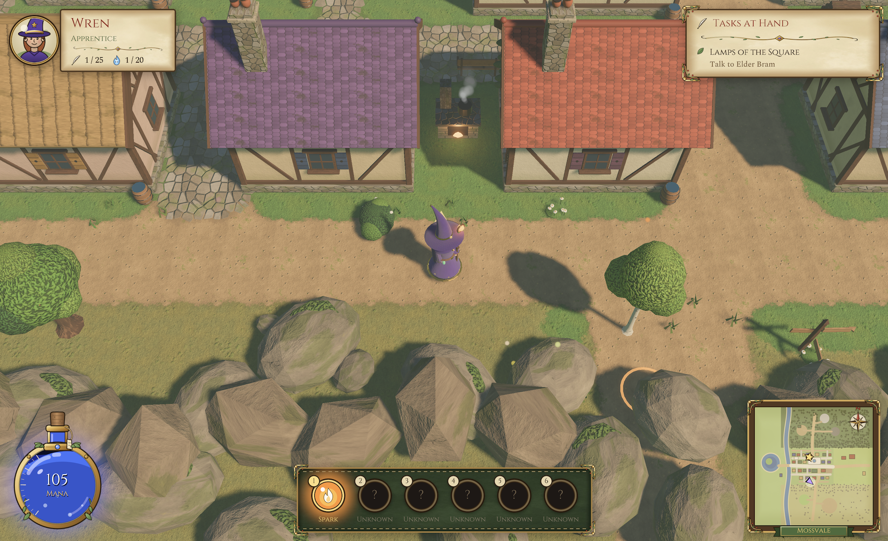](https://www.flecs.dev/games/mossvale/)
[](https://www.flecs.dev/games/astrarium/)
[](https://www.flecs.dev/games/ore_else/)
[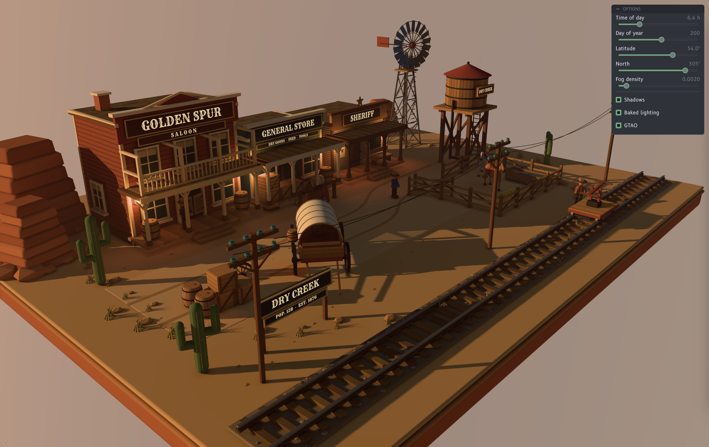](https://www.flecs.dev/games/wild_wild_west/)
[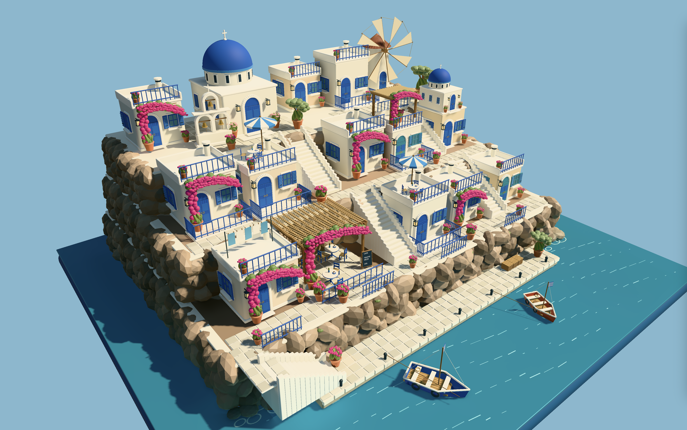](https://www.flecs.dev/games/santorini/)
[](https://www.flecs.dev/games/town/)

## Prerequisites

- [bake3](https://github.com/SanderMertens/bake3)
- [flecs](https://github.com/SanderMertens/flecs)
- C & Rust toolchains

## Build

```sh
bake3 --local-env
```

## Run

```sh
bake3 run apps/boxrun --local-env -- etc/scenes/town.flecs                      # open a scene in a window
bake3 run apps/boxrun --local-env -- --headless --frames 10 etc/scenes/town.flecs  # run 10 frames without a window and exit
bake3 run apps/boxrun --local-env -- --headless --frames 3 --delta-time 1/60 --out /tmp/town.png etc/scenes/town.flecs  # render a frame to a PNG
bake3 run apps/boxrun --local-env -- --headless --timeout 60 --port 27760 etc/scenes/town.flecs  # take shell commands on a REST port
bake3 run apps/boxrun --local-env -- --headless --unguarded --frames 10 etc/scenes/town.flecs  # start even when the machine is oversubscribed
bake3 run apps/boxrun --local-env -- --headless --async-loads --frames 600 etc/scenes/town.flecs  # don't wait for loads, to time frames like a window
bake3 run apps/boxrun --local-env -- --headless --fail-on-error --frames 20 etc/scenes/town.flecs  # exit with 1 when an error was logged
bake3 run apps/boxrun --local-env=agent_a -- etc/scenes/town.flecs              # a separate build environment per agent
bake3 --target em --local-env apps/boxrun                                       # build for the browser
```

## Test

```sh
bake3 runall test/cpu --local-env -- -j 8                     # every CPU test project
bake3 run test/cpu/core --local-env -- -j 8                   # one test project
bake3 run test/cpu/core --local-env -- Args -j 8              # one suite
bake3 run test/cpu/core --local-env -- Args.defaults          # one case
bake3 run test/cpu/core --local-env --test-report-failure-only -- -j 8 --json /tmp/core.json  # record the failures
bake3 run test/cpu/core --local-env -- -j 8 --ignore /tmp/core.json                          # fail only on new failures
bake3 run test/gpu/render --local-env -- -j 4                 # a GPU test project, needs a GPU
python3 tools/integration.py visual                           # render the visual scenes and compare with the baselines
python3 tools/integration.py visual --update-baseline <scene> # store the render of a scene as its baseline
```

## Who is this for?
Box is not a production-ready framework. There's still a lot of experimentation going on, with frequent refactors, public API changes, and many rough edges where something doesn't perform as well as it should yet. Use it if:
- You're looking for examples that help you build engine systems with Flecs
- You're looking for example games that are built with Flecs
- You're looking for examples that show how to use Flecs script
- You want to play around with an agent-friendly framework that has no strings attached

## Why am I building box?
I think dogfooding is the best way to build a useful tool. The best way to dogfood Flecs is to go all in and try to use it for everything a game could need. Box is that:
- It helps me test new features and find bugs
- It exposes friction and feature gaps of the framework
- It's a proving ground for new ideas on how to author ECS games
- It lets me play around with using agents for game development

## AI disclosure
Large parts of this codebase are written and even designed by AI. I do my best to maintain a decent level of quality but there are parts that never had a human review. YMMV if you look at the code directly.

Why build a framework like this? I simply don't have the time or experience to design a framework with this kind of scope upfront. I need to experiment first before knowing what works, instead of spending months on architecture astronauting. AI lets me do this.

The most interesting parts of the code base are (I think):
- How components are used to drive every feature of the engine
- The performance critical parts, like transform propagation, transitions, BVH management
- How games are structured
