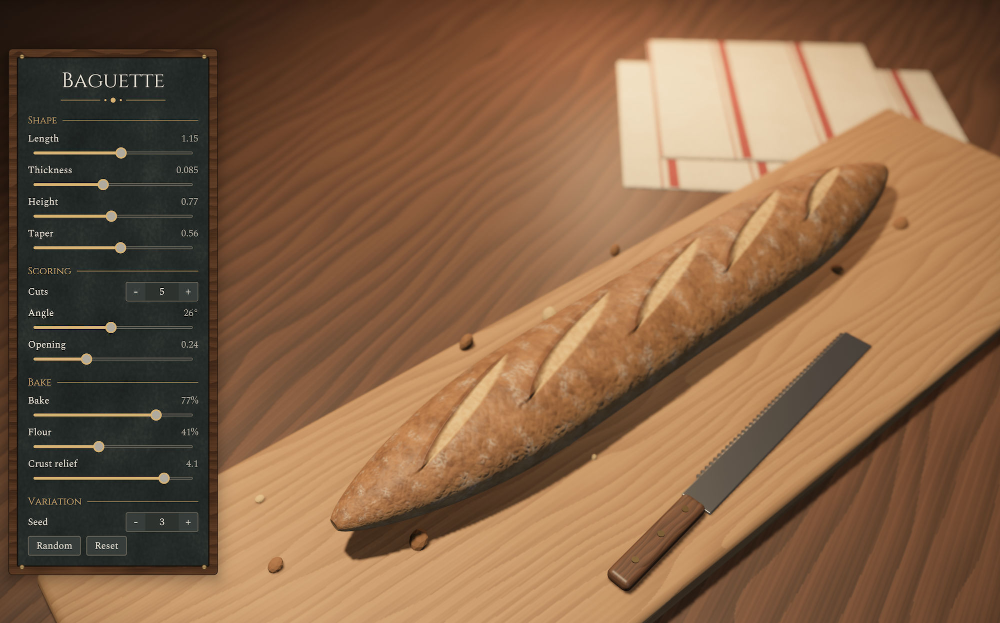
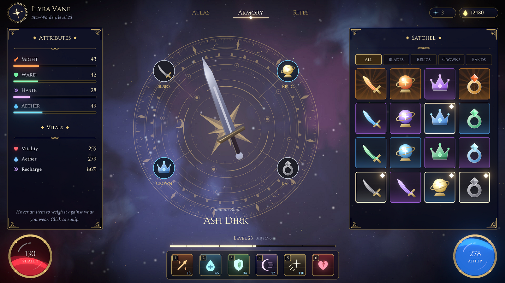
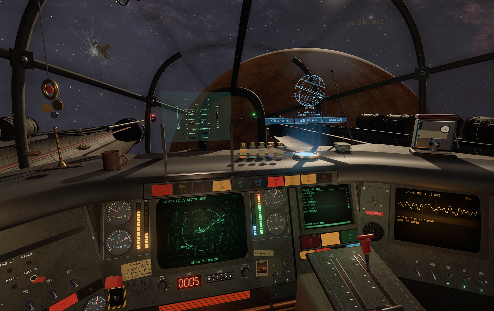
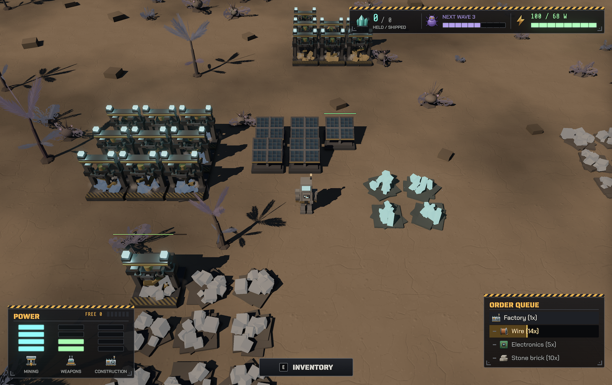
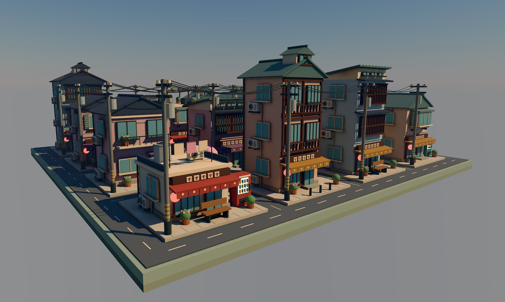

# Box
A data-driven 2D/3D game framework built on [Flecs](https://github.com/SanderMertens/flecs) and WebGPU.

## What is Box?
What if _everything_ in a game was data driven, reactive and procedural? That is design space Box is built to explore.

Take this baguette:



It's not the best looking virtual baguette you've ever seen. But it might be the most _flexible_ one! Everything, from its textures to its shape, to the number of cuts in the loaf are procedural and can be modified at runtime.

Here's a snippet that shows what the geometry part of the baguette looks like:
```cpp
template BaguetteLoaf {
  prop length: f32 = 1.2
  prop thickness: f32 = 0.085
  prop height: f32 = 0.8
  prop taper: f32 = 0.5
  prop cuts: i32 = 5
  prop crust: f32 = 2

  const half: f32 = length / 2
  const bend: f32 = taper * half
  const tip: f32 = thickness * 0.1

  profile {
    Path2D: {
      start: {tip, 0 - half}, 
      segments: [
        {kind: CubicBezier, control1: {thickness * 0.35, 0 - half + bend * 0.05},
          control2: {thickness * 0.99, 0 - half + bend * 0.5}, 
          end: {thickness, 0 - half + bend}},
        {kind: Line, end: {thickness, half - bend}},
        {kind: CubicBezier, control1: {thickness * 0.99, half - bend * 0.5},
          control2: {thickness * 0.35, half - bend * 0.05}, end: {tip, half}}
      ]
    }
  }

  crust_shape {
    Position: {0, thickness * height * 0.88, 0}
    Rotation: {PI / 2, 0, 0}
    Scale: {1, 1, height}
    Lathe: {profile: profile, cap_start: true, cap_end: true, segments: 48, rings: 64}
    Rgb: {255, 255, 255}
    PbrMaterial: {roughness: 1}
    PbrTextures: {albedo: alb, normal: nrm, orm: orm} // procedural textures
  }
}
```

This is [Flecs Script](https://www.flecs.dev/flecs/FlecsScript.html). Everything in [this scene](etc/scenes/baguette), from the engine configuration, the scene structure, the user interface, the geometry and the textures are procedural and defined in flecs script. If the scene had music or sound effects, they would also be created in Flecs Script.

Flecs Script is reactive. What this means in summary is, if value X depends on value Y, and Y changes, then value X will automatically change as well. Change the `length` of a `BaguetteLoaf` instance, and you automatically change the shape of the bread.

This won't get you AAA level fidelity (though it can still produce good looking games, see below!). It does give you extraordinarily dynamic and interactive scenes, where each engine system can integrate seamlessly with any other system.

Box is in the "let's see how far we can push this" phase, with frequent refactors, public API changes, and many rough edges where something doesn't perform as well as it should yet.

## Who is this for?
This is not a production-ready game engine. Use it if:
- You're looking for examples on how to build engine systems with Flecs
- You're looking for example games that are built with Flecs
- You're looking for examples that show how to use Flecs script
- You're looking for a foundation for an agent-friendly game engine

## Why am I building box?
- I use it to test and validate new Flecs features
- I want to see whether an end-to-end Flecs-first engine is viable
- I want to see first-hand where the bottlenecks are when authoring games and fix them
- I want to experiment with agent-based workflows for game development

## AI disclosure
Large parts of this codebase are written and even designed by AI. I do my best to maintain a decent level of quality but there are parts that never had a human review, so YMMV if you look at the code directly.

Why build an engine like this? The first reason is that I simply don't have the time or experience to design an engine with this kind of scope upfront. I need to experiment first before I know what works, instead of spending months of architecture astronauting.


The three things I do care about:
- How easy is it to author content
- How performant is the engine


## Prerequisites

- [bake3](https://github.com/SanderMertens/bake3)
- [flecs](https://github.com/SanderMertens/flecs)
- A Rust toolchain

## Build

```sh
bake3 --local-env
```

## Run

```sh
bake3 run apps/boxrun --local-env -- etc/scenes/town.flecs                      # open a scene in a window
bake3 run apps/boxrun --local-env -- --headless --frames 10 etc/scenes/town.flecs  # run 10 frames without a window and exit
bake3 run apps/boxrun --local-env -- --headless --frames 3 --delta-time 1/60 --out /tmp/town.png etc/scenes/town.flecs  # render a frame to a PNG
bake3 run apps/boxrun --local-env -- --headless --timeout 60 --port 27760 etc/scenes/town.flecs  # take shell commands on a REST port
bake3 run apps/boxrun --local-env -- --headless --unguarded --frames 10 etc/scenes/town.flecs  # start even when the machine is oversubscribed
bake3 run apps/boxrun --local-env -- --headless --async-loads --frames 600 etc/scenes/town.flecs  # don't wait for loads, to time frames like a window
bake3 run apps/boxrun --local-env -- --headless --fail-on-error --frames 20 etc/scenes/town.flecs  # exit with 1 when an error was logged
bake3 run apps/boxrun --local-env=agent_a -- etc/scenes/town.flecs              # a separate build environment per agent
bake3 --target em --local-env apps/boxrun                                       # build for the browser
```

## Test

```sh
bake3 runall test/cpu --local-env -- -j 8                     # every CPU test project
bake3 run test/cpu/core --local-env -- -j 8                   # one test project
bake3 run test/cpu/core --local-env -- Args -j 8              # one suite
bake3 run test/cpu/core --local-env -- Args.defaults          # one case
bake3 run test/cpu/core --local-env --test-report-failure-only -- -j 8 --json /tmp/core.json  # record the failures
bake3 run test/cpu/core --local-env -- -j 8 --ignore /tmp/core.json                          # fail only on new failures
bake3 run test/gpu/render --local-env -- -j 4                 # a GPU test project, needs a GPU
python3 tools/integration.py visual                           # render the visual scenes and compare with the baselines
python3 tools/integration.py visual --update-baseline <scene> # store the render of a scene as its baseline
```

## Screenshots







