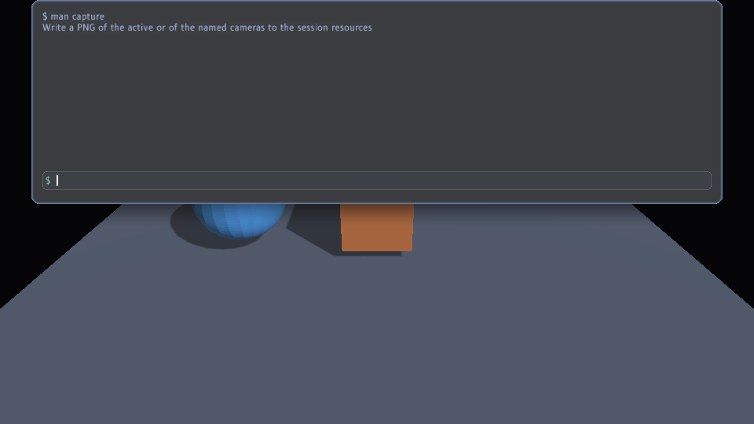

# In game console

## Built

`box.ui` gained `TextInput`, an editable line with a caret of its own: a focused element takes
the characters of the frame and the edit keys around them, walks the lines it submitted with the
arrows and completes a command name or an entity path with tab, through `box_command_complete`
of `box.command`. The `Console` singleton installs the binding, an `InputAction` under `actions`
the grave key fires, and the first open imports `box.command`, loads the script the framework
installs at `etc/ui/console.flecs` and takes the two elements it marks: the one with a
`ConsoleLog` shows the scrollback and the one with a `TextInput` holds the line. Everything the
overlay looks like is in that script. An open console holds the keyboard by disabling every
other input map, a submitted line becomes `TerminalInput` on `terminals.console` and fires
`actions.ConsoleLine`, and the scrollback is the log of that session. Both passes run inside the
existing immediate update, so the pipeline gained no sync point.

## Verified

390 tests over `test/ui` (174, 24 new in `TextInput` and `Console`) and `test/command` (216, 7
new in `Complete`), with `test/input`, `test/picking`, `test/render`, `test/view` and
`test/geometry` green; lint 0. All 74 visual scenes match, the 73 older ones bit identical, and
every command scene passes. `console.flecs` opens the overlay with `key.press` of the grave key,
types a line with `key.type` and captures the screen. `bench/ui` is within noise of the subtree
relayout report.

## Left out

`box_app` does not add the `Console` singleton, because a global action changes what
`action.list` prints and the input command scene pins that; a scene opts in with
`$ { Console: {} }`. The scrollback does not scroll, `Console.open` is the only state it keeps,
and the bench cases call `box_ui_update` directly so they do not measure the two new passes.

