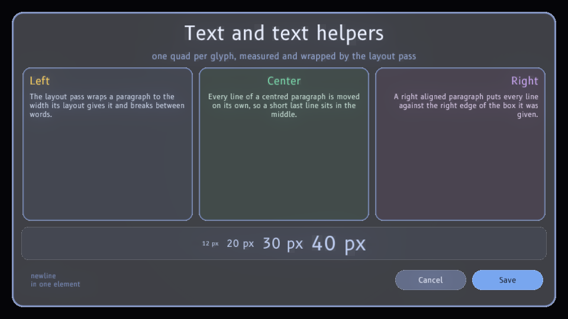

# Text and text helpers

## Built

`box.ui` gained `Font {path, size}` and `Text {value, line_height, align}`. The layout pass
measures a text node while it sizes every other node: its glyphs are rasterized with
stb_truetype into one atlas per font file and em size, the string is wrapped to the width its
`Layout` gives it and the element ends up as large as the lines it holds, so a row fits itself
around a label. The atlas starts at 256 px, doubles in place when a glyph no longer fits and
raises an epoch that rebuilds the elements that drew with it; `box_texture_set_image` uploads it
through `box.texture` like any picture. Every visible glyph becomes an ordinary child of the
element with a `Rect` and an `Image` on the existing 2D shape path, so there is no new renderer
pass; the quads inherit a near black metal with the text color in `Emissive` from a prefab per
atlas, which is what makes them composite instead of adding the glass specular of an alpha
blended surface. `text.measure`, `text.wrap` and `text.label` expose the same measuring,
wrapping and building to a script. The font is `etc/fonts/B612-Regular.ttf` (OFL 1.1), shipped
with the framework `etc`.

## Verified

703 tests over `test/ui` (97, 38 new in `Text` and `Font`), `test/render` (370),
`test/geometry` (96) and `test/view` (140); lint 0. `ui_text.flecs` renders paragraphs at four
sizes and three alignments and a labelled button, and the 68 other scenes stay bit identical.
`ui_text_script.flecs` builds the button and its wrapped paragraph from the helpers only.
`bench/ui`: 1000 glyphs that all change lay out in 1.23 ms, a relayout that changes no string
costs 46 us and measuring 1000 glyphs 5.6 us; the four layout and extract cases are unchanged.

## Left out

A UI root without a `Position` has no world transform, so its subtree is not drawn; the layout
pass should give the root one. Text is not kerned, `Tint` does not reach it because the color
rides in `Emissive`, and the command scene reads the helper output only, because a
`CommandScript` runs while the scene loads, before the first layout.

