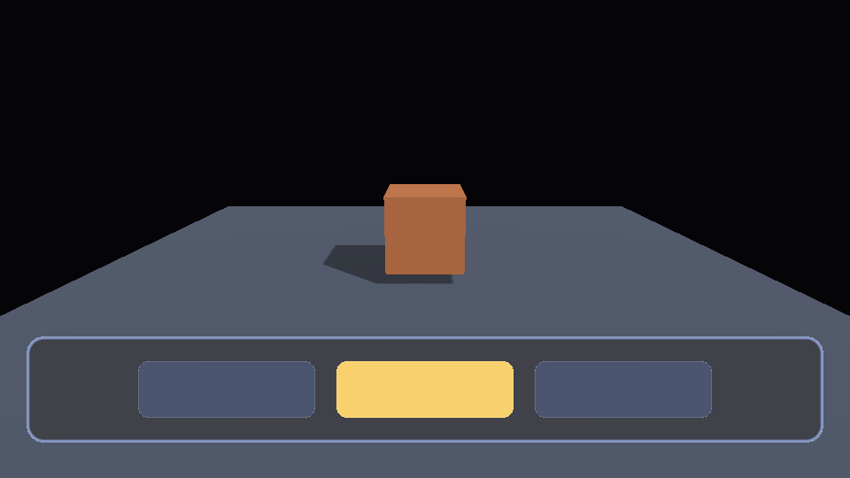

# UI events

## Built

A UI view answers its own pick, because an element has no collider: `box.picking` asks the source `box.ui` installs before the ray query of a view runs, and `box_ui_hit` takes the cursor into the frame of every node of that view and keeps the highest place in the walk, the deepest node of the topmost subtree, so rotation and scale come for free while an empty or a clipped node holds nothing.
A hit consumes the pick before the scene ray runs and raises hover, press, release, click and drag with the bubbling and consumption of 3D picking; an entity that carries an `Action` fires it through the input action layer on a click, in a tree and in a scene alike.
A walked tree invalidates the cached hit, so an element that appears or grows under a still cursor is hovered. Every widget, hover styling included, stays in script.

## Verified

145 tests in `test/ui` (25 new: `Hit`, `Events`), 41 in `test/picking`, with render, view, collision, input and controller green; lint 0.
`ui_hover.flecs` tints the button under the cursor and the 72 other scenes stay bit identical; `ui_events.flecs` clicks a scripted button and logs the click bubbling from its label, the action firing and the hover moving on. Hit testing a 10k node tree costs 83 us against the 1 ms budget of a pick.

## Left out

The hit test walks every node of the view, so its cost follows the tree; a front to back walk with an early out is the follow up. Two trees in one view are ordered by node place, not by their layers, and `Pickable` plays no part in a UI hit.

