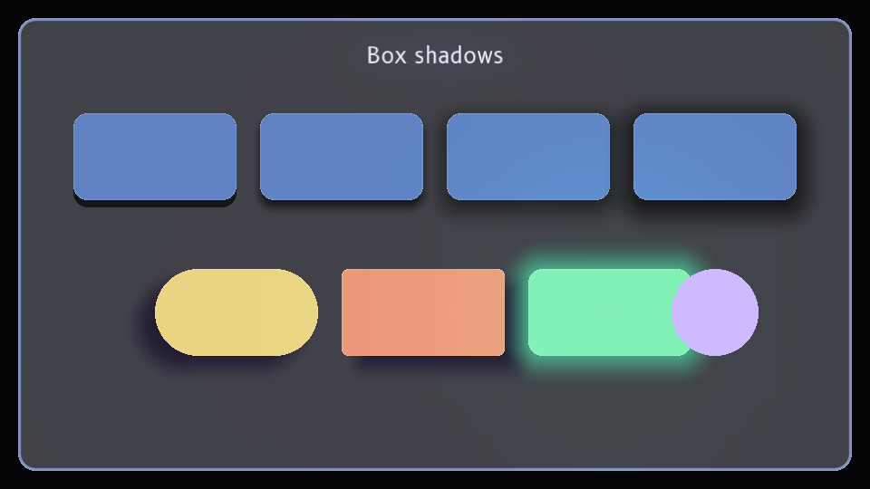

# Box shadows and group transparency

## Built

`BoxShadow {x, y, blur, spread, color}` casts a second quad behind its element: the layout
pass sizes it to the box plus the spread and the blur, gives it the corner radii of the
Border of the element and marks its shape soft, and `include/shape2d.wgsl` fills the rounded
rectangle the blur insets and fades it out over that blur. It is not part of the layout and
sits half a step behind the element it belongs to.

An `Opacity` below one on an element that holds children composites its subtree as one image:
`box.ui` gives it a layer, an orthographic view and a `RenderTarget` the size of its `Bounds`,
the subtree renders into that target at full strength and one quad in the layer above shows
the target with the opacity of the element. The quad is an ordinary sorted draw that names its
target, and the renderer draws it with a mesh pipeline that reads the target out of the slot
the glass model reads the scene copy from. Only a subtree whose opacity reaches a node below
it takes the path, and an inner subtree renders before the one that holds it.

## Verified

726 tests over `test/ui` (120, 20 new in `Shadow` and `Group`), `test/render` (370),
`test/view` (140) and `test/geometry` (96); lint 0. `ui_shadow` shows blur, spread, offset,
color and a rounded shadow; `ui_group_alpha` and `ui_group_alpha_direct` render the same
panel through the texture path and the naive one, where the direct path ghosts the overlapping
circles the texture path hides. The 70 other scenes stay bit identical. `bench/ui`: ten
transparent panels extract in 41 us against 27 us for the same panels opaque, and a frame that
changes nothing costs 34 us; `walk_10k_tree` went 374 to 314 us and `layout_10k_tree` 505 to
532 us, the wider place record of the walk.

## Left out

A subtree is clipped to the Bounds of its element, so a shadow or a child that sticks out of a
transparent parent is cut off. `RenderShape2D` is filled field by field by `box.geometry` from
an uninitialized struct, so the soft flag had to become a tag beside it; a `{0}` there would
close the hole.

